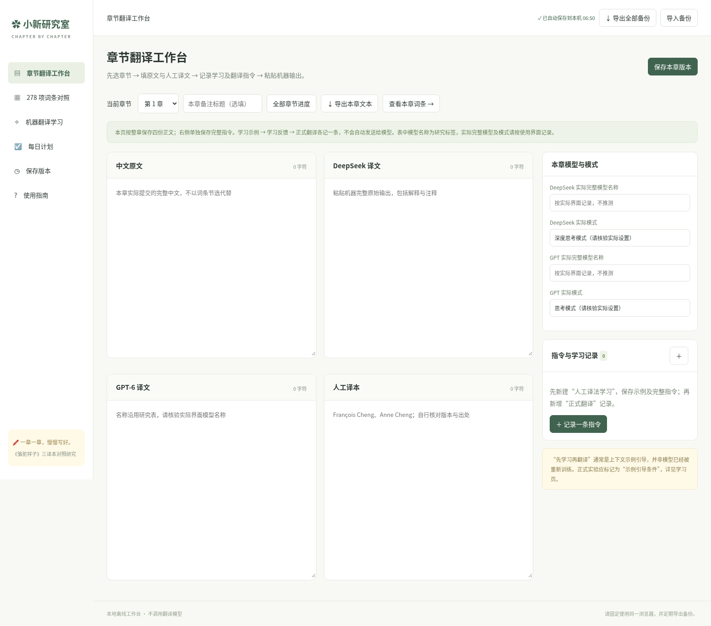
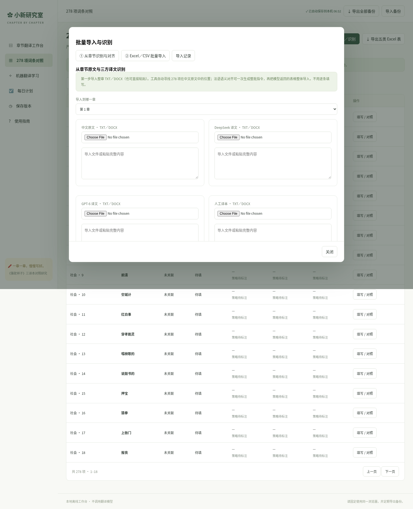

# 小新研究室 · 本地版下载

## 新版 V2：章节翻译工作台（推荐）

[下载新版 ZIP](Research-Studio-v2.zip) · [单文件 HTML](Research-Studio-v2.html) · [操作说明](V2-README.txt)

若页面显示文件内容而非下载，请点击文件页的 **Download raw file（下载原始文件）**。也可在仓库首页点 **Code → Download ZIP**，解压后进入 downloads 文件夹。

下载并解压 Research-Studio-v2.zip，用 Chrome 普通窗口打开其中的 Research-Studio-v2.html。无需 Python、注册或云端部署。

### 每天的使用顺序

1. **章节翻译工作台**：选择第 1—24 章，填写中文原文、DeepSeek、GPT-6、人工译本四份完整正文。
2. **右侧指令记录**：分别记录“人工译法学习”“学习反馈／方法总结”“正式翻译”“纠错／追问”。保留学习材料、完整指令、本次实际输入、完整输出、模型／模式及会话条件。一次记录对应一个模型，重试另记一条。
3. **保存本章版本**：留下完整快照后再改正文。日常输入自动保存，不需要每次手动提交。
4. **278 项词条对照**：以最新 Excel 的五类及 15 字段填写三方译法、中文释义、Aixélá 保留／替代策略与完整原句；关联章节，方便核查。原序号与重复词条均保留。
5. **机器翻译学习**：六节原理与实验设计内容，附论文来源，支持个人笔记和学习进度。
6. **导出全部备份**：每天下载 JSON 到电脑。需整理附录时可导出五类标准 XLSX；该 XLSX 不代替含全部正文、指令、笔记的 JSON 备份。

数据保存在当前浏览器 IndexedDB 中。文件位置、浏览器或电脑改变后，先导出再在新位置导入。清理浏览器数据会影响记录；不用无痕窗口。

模型名称沿用用户研究表的列标签，实际完整名称与模式请依据使用界面记录。学习人工示例通常是上下文引导，不能据此直接声称模型已经微调训练。平台只记录实验，不自动调用模型或生成译文。

## 批量导入与辅助对齐（新功能）

在 **278 项词条对照 → 批量导入／识别** 中，默认打开章节导入工具：

1. 选章节，分别导入中文原文、DeepSeek、GPT、人工译本的 TXT／DOCX，或整章粘贴。DOCX 保留正文脚注、尾注及引用编号；不识别图片和批注。
2. 点击 **自动识别中文词条与位置**。匹配依据是词形，不会自动判断文化含义；段落按此次输入的非空行计数。
3. 点击 **生成整章批量对齐指令**，复制到独立的 AI 对齐会话。该步骤处理已有译文，不是正式翻译实验，不重新翻译。
4. 将模型返回的整张 TSV 表贴回工具，点击 **校验原句并预览批量导入**。不在原译文中的法语摘录会被排除；存在性校验不能证明语义匹配正确。
5. 确认批量写入。默认只填空白；可以同步保存此次章节正文。已有内容需要更新时选择“使用本次非空内容更新”，修改前版本留存。
6. 使用 **含待复核结果** 筛选，核对源译语境后在词条中改为“已核对”。Aixélá 策略仍由研究者标注，辅助对齐不会代为判断。

**没有内置 AI API 调用**：中文检索、文件读取、字段匹配和原句校验均在本机完成；跨语言语义对齐通过你自己的外部 AI 会话辅助完成，不必手工逐词录入。

另一个标签支持已有 XLSX／CSV／TSV 表格或 Excel 复制内容，按类别＋原序号优先匹配，避免重复词串项，支持导入预览、冲突报告及导入历史。JSON 备份与 XLSX 的“对齐核对”工作表都会保留核对状态。

## 旧版 V1（保留）

Research-Studio.html 和 Research-Studio-Mac.zip 是旧版 426 词条应用。V2 使用独立数据库和最新 278 项框架，不自动混合旧版数据。旧版 JSON 请保留，不能直接按 V2 格式恢复。

### Aixélá 策略标注更新

词条填写页将三方“翻译方法”改为策略勾选。保留类：重复、正字法调整、语言性（非文化性）翻译、文外注释、文内注释。替代类：同义替换、有限普遍化、绝对普遍化、归化、删除、自主创造。支持组合策略，并指定主策略供互斥统计。

另外记录标注依据、四方面效果分析（语境意义、文化信息、文学功能、法语表达）、文本内外因素及 AI 生成条件；这些字段会进入 JSON 备份及 Excel 的独立策略标注工作表。旧版自由文字保留原样，不自动归类。

更新前先在原文件导出全部 JSON 备份，再下载新版；若新版显示空记录，导入该备份。不要清除浏览器站点数据。
